  

<h3 align="start"><code>git clone my-brain && enjoy the chaos</code> 🧠</h3>

  
  
  
  
  
  
  
  
  
  
  
  

> I build AI agents that cut costs by 70%, design systems that generate premium websites from a single codebase, and stoic habit apps with philosophers that talk back. Currently a **Full Stack AI Engineer at a software factory**, where I built my own agentic delivery harness — multi-agent orchestration, layered agent memory and human-in-the-loop guardrails — now reused across ~25 client projects. Before that I **led remote dev teams for Europe** as Project Lead, and I keep shipping my own tools on the side.

---

##  What I'm Building

###  Open source

-  **[myjarbis](https://github.com/BraianTroncoso/myjarbis)** `open source · MIT` — Gives Claude Code persistent memory and structured workflows via MCP: one global server, per-project memory, code search and a CLI. Install once, use everywhere. *Not a prompt file. A second memory.* *(TypeScript + MCP + SQLite/FTS5)*

-  **[takeclass](https://github.com/BraianTroncoso/takeclass)** `open source · MIT` — Turns your day's git diff into an English-practice session: vocabulary, a reading script and drills from the code you actually shipped today. *(Claude Code skill + slash command)*

-  **[GesturePilot](https://github.com/BraianTroncoso/GesturePilot)** — Control Claude Code with hand gestures and voice from your webcam: MediaPipe hand-tracking + local Whisper + Piper TTS, no keyboard needed. *(Python + MediaPipe + Faster-Whisper)*

-  **[DevLog](https://github.com/BraianTroncoso/devlog)** — A living, bilingual logbook of applied AI: a 12-module *school* (Fundamentals → Production) plus a *Radar* feed that keeps every module current. *Not a course that ages.* *(Astro + Starlight + Mermaid)*

-  **[Apotheosis](https://github.com/BraianTroncoso/apotheosis)** — A consciousness laboratory inside a living world: an agent-based civilization that forages, specializes, raises families and — with no script at all — *invents faith*. Beneath it, one experiment: can a simulated mind come to suspect it is simulated? *Not a sandbox. A hypothesis test.* *(Three.js + Vue 3 + Web Workers + Ollama)*

-  **[aura-agent](https://github.com/BraianTroncoso/aura-agent)** `open source · MIT` — Your personal AI agent à la *Her*, living in Telegram: it reads your email, calendar and assigned PRs and writes your daily standup, all on a **local** model so your data never leaves your machine. *Not a chatbot. A second mind.* *(FastAPI + SQLite + Ollama + Telegram)*

-  **[hookforge](https://github.com/BraianTroncoso/hookforge)** `open source · MIT` — Turns any web app into a Linear/Vercel-style launch video from a config: the live UI inside a floating device on a branded stage, 3D camera, animated cursor, music and narration. *Never a screen-share with text on top.* *(Remotion + Playwright + ffmpeg)*

-  **[Data4Sales](https://github.com/BraianTroncoso/Data4Sales)** — A B2B multi-tenant platform that ingests a retailer's sales, exposes them in an operational dashboard and lets you act on its buyers: RFM segmentation, dirty-data handling and verifiable tenant isolation, measured at 255k orders. *Not a CRUD. A decision record* — 35 of them. *(Laravel + Vue 3 + Docker)*

-  **[collateral-health](https://github.com/BraianTroncoso/collateral-health)** `open source · MIT` — Given a Collateral Arrangement and the event that triggered the check, what is its health status? A pure, zero-dependency domain library: no clock, no randomness, no I/O — so an HTTP handler, a revaluation job and a replay of yesterday's book all get the same answer. *(TypeScript + Vitest)*

-  **[trainme](https://github.com/BraianTroncoso/trainme)** `open source · MIT` — A tiny CLI that preps you for an interview from your *persona* + a job posting: a 1-hour roadmap, likely Q&A and stack tips, no retyping. *Not a prompt you retype. A CLI that preps you in minutes.* *(Python + Rich + pypdf)*

-  **[GAME-JAM-FAD-CUYO-2022](https://github.com/BraianTroncoso/GAME-JAM-FAD-CUYO-2022)** — A complete game built in under 12 hours at a game jam. Ship or die.

###  Private — I write about these on [LinkedIn](https://www.linkedin.com/in/braian-troncoso)

> The code stays closed; the thinking doesn't. Each one links to where I talk about it.

-  **[Frontdeck](https://www.linkedin.com/in/braian-troncoso)** `private` — A design-system platform that generates premium sites (each with its own identity and architecture) from one codebase: 474+ Vue components, 22 themes, 200+ variants. *Not a template. A design engine.* *(Laravel 12 + Vue 3 + Filament + Three.js + Tailwind 4)*

-  **[Cortexa](https://www.linkedin.com/in/braian-troncoso)** `private` — Turns your team's knowledge into AI agents with judgment and tone, cloning real collaborators via `SOUL.md` heuristics; ships a 6-agent fintech demo with compliance audits. *Not a chatbot. A digital twin of your company.* *(Paperclip + Ollama + Marp)*

-  **[LevelUp](https://www.linkedin.com/in/braian-troncoso)** `private` — A stoic habit-tracker PWA: 23 daily habits, an honest self-evaluation flow, and live chat with Marcus Aurelius, Seneca and Epictetus (Llama 3.3). Trilingual, offline-capable. *(Next.js 16 + Groq + PWA)*

-  **[fracarg](https://www.linkedin.com/in/braian-troncoso)** `private` — An Argentine remix of the 1997 DOS classic *Fracas*: a wizard Bomberman with exploding cauldrons, story bosses and survival waves over a deterministic, server-ready game core. *Not a clone. A nostalgia engine.* *(Phaser 3 + TypeScript + Vite + Supabase)*

-  **[Voicepen](https://www.linkedin.com/in/braian-troncoso)** `private` — Lend your voice to an agent and it writes your LinkedIn/Instagram posts in your exact tone, grounded on fresh news so it never invents facts. *Not a generic AI writer. A pen that knows your voice.* *(Next.js 16 + Drizzle/Turso + Groq)*

-  **[GymSphere](https://www.linkedin.com/in/braian-troncoso)** `private` — Gym-management platform: members, plans, attendance and billing in one place.

-  **[IwannaWork](https://www.linkedin.com/in/braian-troncoso)** `private` — A job-hunting autopilot: it reads a posting, fills multi-step application forms end to end and keeps every submission tracked in one dashboard, so the search keeps running while you work. *(Python + FastAPI + Vue 3)*

-  **[age-boys](https://www.linkedin.com/in/braian-troncoso)** `private` — A match tracker for an Age of Empires 3 circle of friends: ELO ratings that actually settle arguments, tournaments with brackets, head-to-head records, achievements and a civilization roulette. *(Astro + Firebase + Turso)*

-  **[SecondBraian](https://www.linkedin.com/in/braian-troncoso)** `private` — A personal knowledge vault in Obsidian (PARA + Maps of Content, 10 templates), where chaos becomes clarity. *(Obsidian)*

---

##  Dmeter — Co-Founder *(Sep 2023 – Present)*

**[dmeter.com.ar](https://dmeter.com.ar/en/)** — Digital solutions that save time, reduce errors, and grow businesses. Technology with purpose, real results.

Building and scaling the product from scratch alongside the technical and business side — architecture decisions, client delivery, and everything in between.

---

## 🤝 Connect

---

Random Facts

- I can't live without coffee
- Build and use custom MCP servers in my daily dev workflow
- Shipped a design engine with 474+ components from a single Laravel codebase
- Finished a complete game in under 12 hours at a game jam
- Powered by mate and stoic philosophy
- Naruto is the best anime in the world
- If you believe it, you can do it :)

---

> *"Clean code, tested systems, and AI that actually ships — that's what I build."*
